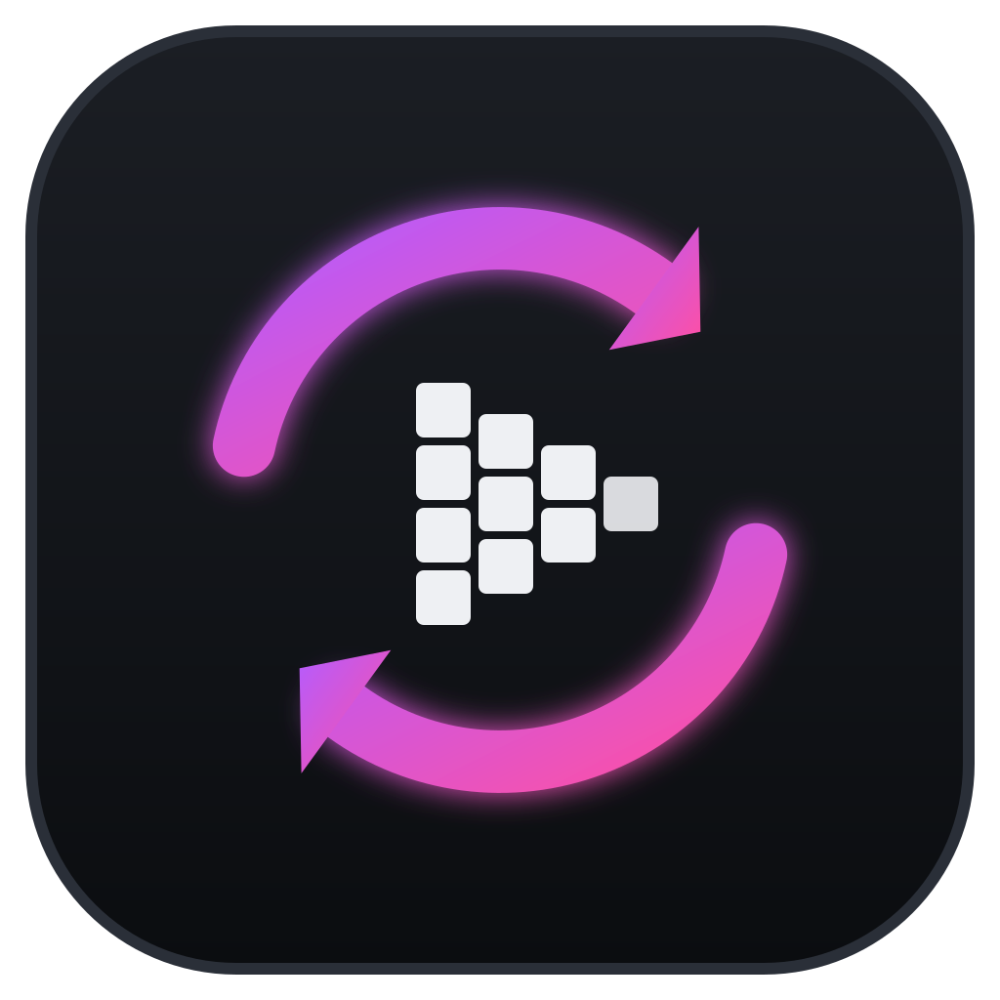

<p align="center"></p>

# RenderPRO

**PT** · Conversor de codecs para o **PLAYERSLICE** e o **VIDEOHOST PLAYER** (na linha do Alley da Resolume). Arrastas os vídeos, carregas em **RENDER**, escolhes o player e o RenderPRO põe cada vídeo no codec, tamanho e frame rate recomendados — e só entrega o ficheiro depois de confirmar que está perfeito.

**EN** · Codec converter for **PLAYERSLICE** and **VIDEOHOST PLAYER** (in the spirit of Resolume Alley). Drop your videos, press **RENDER**, pick the player and RenderPRO puts each video in the recommended codec, size and frame rate — and only hands over the file once it has checked it is perfect.

Criado por / Created by **Daniel Nunes** — [github.com/NunesDanielPT](https://github.com/NunesDanielPT)

---

## Download

[**RenderPRO-Setup.exe**](https://github.com/NunesDanielPT/RenderPRO/releases/latest/download/RenderPRO-Setup.exe) (Windows 10/11, 64 bits) — ou instala pelo **ShowKit**.

## Como funciona

1. Arrastar vídeos ou pastas para a janela (ou *Adicionar vídeos*). Cada vídeo é analisado: codec, resolução, frame rate, som, transparência, VFR, entrelaçado.
2. **RENDER** abre as definições: player, codec (*Automático* = recomendado para cada vídeo), resolução, frame rate, som e pasta de saída. À direita vê-se o que vai acontecer a cada vídeo, com avisos.
3. *Iniciar render*: barra de progresso, fps, velocidade e tempo restante por vídeo.

## Presets recomendados

| Player | Vídeo | Codec | Porquê |
|---|---|---|---|
| PLAYERSLICE | normal | **HAP** | Vai direto para a gráfica: o mais leve com ledwalls e muitas layers |
| PLAYERSLICE | com transparência | **HAP Alpha** | Mantém o alfa e continua na gráfica |
| PLAYERSLICE | gradientes suaves | HAP Q (manual) | Melhor cor, ficheiros ~2× maiores |
| VIDEOHOST | até 1080p60 | **H.264** | Leve para a CPU, keyframe a cada segundo (cues arrancam logo) |
| VIDEOHOST | acima de 1080p60 | **HAP** | Custo de descodificação constante, arranque instantâneo |
| VIDEOHOST | com transparência | **HAP Alpha** | Mantém o alfa |

Pormenores aplicados automaticamente:

- **HAP**: largura e altura múltiplas de 4 (margem preta à direita/em baixo, píxeis 1:1 — ou redimensionar), compressão Snappy, **4 chunks** em 1080p e **8** acima disso (o PLAYERSLICE descomprime-os em paralelo), `.mov`.
- **H.264**: High, 4:2:0 8 bits (seguro para NVDEC/D3D11VA), keyframe a cada segundo, GOP fechado, bitrate máximo limitado, `.mp4` com *faststart*. Bloqueado acima de 4096 px no PLAYERSLICE (limite do NVDEC) — H.265 vai até 8192.
- **Som**: PCM 16 bits 48 kHz no `.mov` (intercalado em blocos de ~10 ms), AAC 320k 48 kHz no `.mp4`, estéreo, sincronizado com o vídeo. Normalização EBU R128 opcional (duas passagens).
- **Frame rate** sempre constante (vídeos VFR de telemóvel corrigidos), desentrelaçamento automático, rotação de telemóvel aplicada, píxeis não quadrados corrigidos, matriz de cor BT.709 em HD.

## Fiabilidade

- O render escreve num **ficheiro temporário** ao lado do destino; só depois de verificado é renomeado. Nunca aparece um vídeo meio escrito.
- **Verificação**: o ffprobe confirma codec (e tipo de HAP), tamanho, duração e som; a *verificação completa* descodifica o ficheiro final do princípio ao fim. Se falhar, o ficheiro é descartado e o erro é mostrado.
- **Espaço em disco** verificado antes de começar.
- O **original nunca é alterado**; sem *Substituir* nunca se apaga nada (nomes `video_HAP (2).mov`).
- FFmpeg parado sem progresso durante 2 minutos é terminado; cancelar apaga o temporário.
- Se o RenderPRO fechar ou crashar, os FFmpeg morrem com ele (Job Object do Windows) e os temporários são apagados no arranque seguinte.
- Prioridade baixa por defeito (não rouba CPU a um player aberto na mesma máquina); o PC não entra em suspensão durante um render.
- Registos em `%LOCALAPPDATA%\pt.danielnunes.renderpro\logs\` (Definições → Abrir pasta de registos).

## Desenvolvimento

[Tauri 2](https://tauri.app) (Rust) + HTML/CSS/JS sem framework. O motor está em `src-tauri/src/` (`presets.rs` decide tudo e é testado sem I/O; `render.rs` corre o FFmpeg).

```bash
npm install
pwsh scripts/fetch-ffmpeg.ps1          # FFmpeg estável GPL (BtbN) para src-tauri/ffmpeg/
npx tauri dev
cargo test --manifest-path src-tauri/Cargo.toml                       # testes unitários
cargo test --manifest-path src-tauri/Cargo.toml -- --include-ignored  # + renders reais (ffmpeg no PATH)
```

Abrir `ui/index.html` num browser mostra a interface com dados simulados.

**Lançar uma versão:** subir a versão em `src-tauri/tauri.conf.json`, `src-tauri/Cargo.toml` e `package.json`, escrever a secção no `CHANGELOG.md` e fazer push para `main`. A CI compila em Windows, corre os testes (incluindo renders reais) e publica a release `vX.Y.Z` com o `RenderPRO-Setup.exe`.

## Licença

RenderPRO © 2026 Daniel Nunes, todos os direitos reservados. Inclui o [FFmpeg](https://ffmpeg.org) (build GPL da [BtbN](https://github.com/BtbN/FFmpeg-Builds)) como programa separado; licença em `ffmpeg/FFMPEG-LICENSE.txt` na pasta de instalação e código-fonte em ffmpeg.org.
